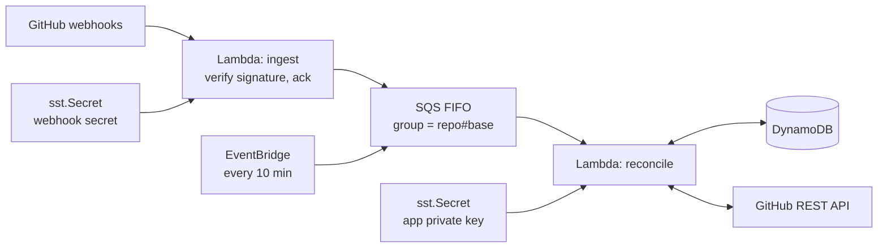

# Merge queue — design

**Status:** the decision core, reconcile loop, simulator, webhook intake,
GitHub REST adapter, DynamoDB store, Lambda handlers and SST configuration
are implemented. Nothing is deployed; see [`docs/setup/`](./setup/README.md).
**Date:** 2026-11-23

A GitHub App that lands pull requests through a batched, serialized queue, so
CI cost grows with the number of *batches* merged instead of with the square of
the number of open pull requests.

## 1. The problem

GitHub's native merge queue is not available for private repositories below
Enterprise Cloud. The usual substitute is a loop like this:

1. A workflow enables auto-merge on every pull request.
2. The default-branch ruleset requires status checks with branches up to date
   (`strict`).
3. Another workflow fires on every push to `main` and calls `update-branch` on
   every open PR that is behind (or people click the button).
4. Each update is a `pull_request: synchronize`, which reruns that PR's full CI.
5. Auto-merge lands the next green PR, which is a push to `main` — go to 3.

With *n* PRs open at once, landing all of them costs roughly

    n  +  (n-1) + (n-2) + … + 1   =   n + n(n-1)/2   full CI runs

Ten concurrent PRs is up to 55 full runs; twenty is 210. (An upper-bound
model, not a measurement — `cancel-in-progress` trims some of it.) With AI
agents opening many overlapping PRs, that exhausts a month of included Actions
minutes in days. This is the cost a queue removes: every PR is retested
against every other PR's landing, one at a time.

## 2. What the queue does instead

- A PR is tested **once on its own head** (optional, can be a cheap subset)
  and **once as part of a batch** against the exact `main` it will land on.
- Nothing ever updates a PR branch. `strict` and any branch-updating
  automation go away.
- Up to *B* PRs share one batch run. Ten PRs with *B* = 5 is 2 batch runs.
- Textual conflicts between overlapping PRs are found while *building* the
  batch — a server-side merge that returns 409 — before any CI minute is spent.

| | Today | Queue, B=5 |
| --- | --- | --- |
| Full CI runs to land 10 concurrent PRs | up to 55 | 10 PR runs + 2 batch runs, or ~2 if PR-level CI is slimmed |
| Runs triggered by someone else's merge | n-1 per merge | 0 |
| Conflict discovered | after a CI run on the updated branch | at batch build, free |

## 3. Decisions

| Question | Decision | Why |
| --- | --- | --- |
| Language | **TypeScript** (strict), Node 24 | First-party `octokit` App SDK: JWT/installation auth, webhook signature verification, generated types for every payload and endpoint. Matches this repository's existing pnpm/Biome/Vitest toolchain. Go was the runner-up (better cold start, single binary); the SDK and typed payloads matter more here than 150 ms. |
| Framework | `octokit` `App` directly, **not Probot** | Probot assumes a long-lived server and adds a layer between the code and the API. |
| Hosting | **AWS Lambda + Function URL**, in whatever account you deploy to | $0 at rest. No NAT, no VPC, no container, no fixed monthly charge. |
| Serialization | **SQS FIFO**, `MessageGroupId = repo#base` | Gives exactly-one-reconciler-at-a-time per queue for free, plus dedupe on `X-GitHub-Delivery`. |
| State | **DynamoDB** on-demand, single table | Queue order and batch records. Everything else is re-read from GitHub. |
| Git operations | **API only, never clone** | The app never has repository code on disk and never executes it. Batches are built with `POST /repos/{o}/{r}/merges` and the Git Data API. |
| Core shape | **Pure decision function + thin shell** | `decide(snapshot) -> Action[]`, no I/O. Tested against an in-memory GitHub simulator, so agents can develop it without touching a live repo. |
| Merge method | **Squash** by default, `merge` (fast-forward) optional | See §6 for what each guarantees. |
| IaC | **SST v4** (`sst.config.ts`) | Already this repository's deploy tool; has first-class Function, Queue, Dynamo, Cron and Secret components. |
| Secrets | `sst.Secret`, never source or plain env | See §10. |

Rejected: a queue implemented as GitHub Actions workflows (burns the minutes it
is meant to save, and has no durable state); a container on the runner fleet
(the queue would be down whenever the runner host is); Vercel functions (no FIFO
primitive, so serialization would need a second vendor).

## 4. Architecture



**Ingest** verifies `X-Hub-Signature-256`, drops events that cannot matter,
and enqueues a *poke* `{installation, repo, base}`. It makes no GitHub calls
and returns in milliseconds.

**Reconcile** treats the event as a hint, not as data. On every poke it:

1. loads the queue record from DynamoDB;
2. reads the truth from GitHub — open PRs, their head SHAs, `main`'s SHA, the
   check runs on the current batch SHA;
3. calls `decide(snapshot)`;
4. executes the returned actions, each idempotent;
5. writes the record back with a version condition.

A queue that holds nothing (no PRs, no batch, no commands, never batched) is
deleted rather than written, and a poke for a branch with no record and no
open PR targeting it stops after one `GET /pulls`. Every push names its branch
as a base, so without this a repository with many branches accumulates one
record per branch pushed, and every check event fans out to all of them.

A missed, duplicated, or out-of-order webhook therefore cannot corrupt
anything; the 10-minute sweep repairs a missed one. This is the property that
makes the service safe to run on at-least-once delivery.

```
src/
  core/         decide(), types, config schema — pure, imports nothing outside core
  ports.ts      GitHubPort and QueueStore: the only way out of the core
  reconcile.ts  read → decide → act loop
  sim/          in-memory GitHub implementing GitHubPort, plus scenarios
  ingest/       signature verification, event → poke routing
  env.ts        deployment environment schema
  github/       REST adapter implementing GitHubPort, config loader, HTTP fake for tests
  store/        DynamoDB record + optimistic locking
  handlers/     Lambda entrypoints; wake-ups and fan-out per ADR-0027; one log line per message
  cli/          `queue:plan`, the read-only dry run
sst.config.ts   functions, queue, table, schedules, secrets
docs/
```

## 5. Queue lifecycle

```
            ┌────────── head SHA changed / closed / dequeued ──────────┐
            ▼                                                          │
 open ─► QUEUED ─► BATCHED ─► TESTING ─► LANDING ─► MERGED             │
            ▲          │          │                                    │
            │          │ 409      │ red                                │
            │          ▼          ▼                                    │
            └────── EJECTED (comment explains why) ◄───────────────────┘
```

**Enqueue.** Default `enqueue: auto` — every non-draft, same-repo PR is queued
as soon as its own required checks are green, which replaces an auto-merge
workflow outright. Also supported: a `queue` label, or a `/queue` comment. Fork PRs are never
queued: they are attacker-authored by definition, and a batch branch runs with
repository secrets.

**Settle.** A PR enters a batch only after its head has been unchanged for
`settle_seconds` (default 120). Agents push in bursts; this stops a batch being
built on a commit that is about to be superseded.

**Build.** Take up to `batch_size` queued PRs in order. On a scratch branch
`mq-build/<id>` (which no workflow triggers on), merge each PR head in turn. A
409 ejects that PR with a comment naming what it conflicted with, and the batch
continues without it. When done, create `mq/<base>/<id>` at the final SHA —
**one ref creation, so exactly one `push` event and one CI run** — and delete
the scratch branch.

**Test.** Repositories add one trigger to their CI workflow:

```yaml
on:
  pull_request:
  push:
    branches: ['mq/**']
```

The app watches check runs on the batch SHA against the repo's configured
`required_checks`.

**Land.** All green and `main` has not moved → land (§6), delete the batch
branch, start the next batch. `main` moved underneath (a direct push) → the
batch is stale; cancel its runs and rebuild.

**Fail.** A red batch of one ejects that PR. A red batch of several is split
in half and each half retested; the half that passes lands, the other splits
again. Worst case is ~log₂B extra runs, paid only when something is actually
broken. `on_failure: serial` is available for repos where CI is cheap.

**Fast path.** If the queue is empty, the PR's head is already based on
current `main`, and its own checks are green, the PR's CI run *is* the batch
run. It lands immediately with no second run.

**Supersession.** Whenever a batch is abandoned or a PR head moves, the app
cancels the now-useless workflow runs (`POST /actions/runs/{id}/cancel`).

## 6. Landing, and what is actually guaranteed

The invariant: **the tree that lands on `main` is byte-identical to the tree
CI tested.**

**Squash mode (default).** The batch is built as a chain of squash commits —
merge PR head into the scratch branch, then rewrite it as a single-parent
commit with the same tree. On green, the app calls
`PUT /pulls/{n}/merge` (`merge_method: squash`, `sha:` the tested head) for
each PR in order, then compares `main`'s tree SHA to the tested tree SHA. They
must match because the merges are the same three-way merges in the same order
on the same base. If they ever do not, the queue for that repo **freezes** and
opens an issue; it does not guess. PRs show as *Merged* normally.

Caveat: landing is N API calls, not one atomic operation. If call 3 of 5
fails, `main` holds a tested-as-a-prefix-but-not-as-a-tip state; the remaining
PRs requeue. Each call is also a `push` to `main`, so deploy-on-push workflows
need a `concurrency` group that collapses them (most already have one).

**Merge mode.** The batch is a chain of real merge commits and landing is a
single fast-forward of `main` to the tested SHA — atomic, one push event, and
GitHub marks every PR *Merged* because its head is now an ancestor. Strictly
stronger, but it puts merge commits on `main`. Offered per repo.

## 7. Gating without `strict`

The ruleset on `main` changes from "these N CI checks, strict" to **one**
required check, `merge-queue`, pinned to this app's integration id so nothing
else can satisfy it, with `strict` off.

- The app posts `merge-queue` on every PR head: `queued (#3 of 7)`, `testing
  in batch 41`, `ejected: conflict with #212`. It turns green only at the
  moment the app lands the PR.
- No ruleset bypass is needed in squash mode. Merge mode needs the app as a
  bypass actor for the "require a pull request" rule.
- A human who must land something by hand uses their existing admin bypass,
  and the queue treats the resulting push like any other move of `main`.
- `strict` is read on every reconcile from the branch rules
  (`GET /repos/{o}/{r}/rules/branches/{base}`, which includes organization
  rulesets). If it is on, enforce mode **pauses**: any batch not yet landing
  is abandoned, nothing new is built, each wanted PR reports `queue paused: …`,
  and the reconcile log line is `level: "warn"`. Nothing is stored, so the
  queue resumes on the first reconcile after `strict` is turned off. Shadow
  mode only logs the warning, so a repository can be previewed before its
  ruleset changes. Classic branch protection is not readable with the app's
  permissions.

This requires rulesets on private repositories, which need a paid plan (Team
or above). On a Free plan the queue still works, but the gate is a
convention rather than something GitHub enforces.

## 8. Talking to agents

Agents are the main users, so every state change is machine-readable:

- The `merge-queue` check run carries the state and a one-line reason.
- An ejection posts **one** comment (edited in place on repeat) with a fenced
  JSON block: `{"reason": "conflict" | "checks_failed" | "merge_failed",
  "conflicts_with": [..], "failed_checks": [..], "run_url": ".."}`.
- `/queue` and `/dequeue` comments, accepted only from the repository's
  owners, members and collaborators; a `queue:jump` label moves a PR to the
  front of the next batch. `/queue unfreeze` resumes a frozen queue.

An agent subscribed to its PR sees the ejection, fixes or rebases, pushes, and
the PR re-enters on its own.

## 9. Per-repository configuration

`.github/merge-queue.yml` on each repository's default branch. Org-wide
defaults can live in the org's `.github` repository:

```yaml
enabled: true
mode: shadow             # shadow (default: report only, never merge) | enforce
enqueue: auto            # auto | label | comment
merge_method: squash     # squash | merge
required_checks: [ci, lint]   # must pass on the batch commit; the only required key
pr_checks: [ci, lint]    # must pass on a PR's own head; defaults to required_checks
batch_size: 5
settle_seconds: 120
max_wait_seconds: 300    # ship a short batch rather than wait for a full one
on_failure: bisect       # bisect | serial
review_requirements: auto  # auto: follow the base branch's review rules | none
```

Unknown keys are rejected, so a typo cannot silently disable a setting.

**Review requirements.** A PR that GitHub would refuse to merge must not take
a place in a batch, or the batch spends CI and then ejects it. With
`review_requirements: auto` (the default) the queue reads the rules that apply
to the base branch (`GET /repos/{owner}/{repo}/rules/branches/{branch}`,
repository and organization rulesets) and holds a PR back, reported as
`waiting: …`, until it meets what their `pull_request` rules require:

- `required_review_thread_resolution`: no unresolved review conversations;
- `required_approving_review_count`: that many reviewers whose latest review
  approves.

Conversations and approvals are read with one GraphQL query per 50 open PRs,
and only when a rule requires them. Classic branch protection is not readable
without the Administration permission; on such a repository set what you need
by hand, or `none` to ignore review rules altogether. Unreadable rules count
as none. Code-owner review, last-push approval and stale-review dismissal are
not modelled yet: a PR held back only by those is still queued and is ejected
if GitHub refuses the merge. The
fast path (§5) applies only when `pr_checks` covers every `required_checks`
entry; with thinner PR-level CI a lone PR still gets a batch run.

## 10. Service configuration and secrets

Nothing account- or org-specific is committed. Every deployment supplies its
own values; this repository contains names and placeholders only.

| Name | Secret? | Where it lives | Purpose |
| --- | --- | --- | --- |
| `GITHUB_APP_PRIVATE_KEY` | **yes** | `sst secret set GithubAppPrivateKey` | PEM used to sign the app JWT. Readable only by the reconcile function. |
| `GITHUB_WEBHOOK_SECRET` | **yes** | `sst secret set GithubWebhookSecret` | Verifies `X-Hub-Signature-256`. Readable only by the ingest function. |
| `GITHUB_APP_ID` | no | deploy environment variable | Identifies the app registration. |
| `MERGE_QUEUE_ALLOWED_OWNERS` | no | deploy environment variable | Comma-separated org/user logins this deployment serves. Events from any other installation are dropped. |
| `MERGE_QUEUE_QUEUE_URL`, `MERGE_QUEUE_QUEUE_ARN`, `MERGE_QUEUE_TABLE`, `MERGE_QUEUE_SCHEDULER_ROLE_ARN`, `MERGE_QUEUE_SCHEDULE_GROUP` | no | set by the deploy from the resources it creates | Where pokes, state and wake-ups go. |
| `AWS_DEPLOY_ROLE_ARN` | no | GitHub Actions *variable* on the protected `production` environment | OIDC role the deploy workflow assumes. No long-lived AWS keys anywhere. |
| AWS account id, region | no | implied by the role / SST provider config | Never written into docs or source. |

Rules:

- `sst.Secret` values are stored encrypted in the deploying account's SSM
  Parameter Store and are linked only to the function that needs them.
- For local development the same names are read from an untracked `.env`
  (`.env.example` lists them, empty). `*.pem` and `.env*` are git-ignored.
- Secret values are never logged, never put in check-run output or PR
  comments, and never echoed by CI. The gitleaks workflow scans full history
  on every PR.
- Docs and examples use placeholders (`<AWS_ACCOUNT_ID>`, `<ORG>`), never real
  values.

## 11. App registration

Each adopter registers **their own** private GitHub App; there is no shared
hosted instance.

| Permission | Level | For |
| --- | --- | --- |
| Contents | write | create/delete batch branches, merge |
| Pull requests | write | merge, comment, label; review threads and approvals (§9) |
| Checks | write | the `merge-queue` check |
| Commit statuses | read | repos that report via statuses |
| Actions | write | cancel superseded runs |
| Workflows | write | without it, a batch containing a `.github/workflows/**` change cannot be pushed |
| Issues | write | ejection comments and the "queue frozen" issue (both use the issues API) |
| Metadata | read | mandatory; also reads the base branch's rules (§9) |

Events: `pull_request`, `push`, `check_run`, `status`, `issue_comment`,
`installation_repositories`. Ingest pokes only on a check that finished: a
`completed` check run that is not the queue's own, or a non-pending status.
Starting and in-progress events change nothing the queue decides on, and on a
busy repository they outnumber the rest by an order of magnitude.

Set "Where can this GitHub App be installed?" to *Only on this account*.

## 12. Security

This app holds `contents: write` on every repository it is installed on, so:

- the private key is linked only to the reconcile function; ingest cannot
  read it;
- installation tokens are minted per reconcile, scoped to the single
  repository being reconciled, and never logged;
- the app never clones, builds, or executes repository content;
- only same-repo PRs are queued, so a batch branch exposes secrets to nothing
  that `pull_request` CI on that PR did not already see;
- the Function URL accepts only signature-verified POSTs, and only from
  installations in `MERGE_QUEUE_ALLOWED_OWNERS`.

## 13. Cost and rollout

Lambda, SQS, DynamoDB on-demand, EventBridge and SSM standard parameters at a
small org's event volume sit inside the AWS always-free allowances, with no
fixed-charge component. Verify against your own account rather than assuming.

1. Build `core/` and the simulator. No AWS, no GitHub.
2. Register the app; deploy.
3. **Shadow mode** on your busiest repository: the app posts what it *would*
   do and merges nothing. Compare against what actually merged.
4. Enforce on that repository: swap the ruleset, add the `mq/**` trigger,
   remove its auto-merge workflow.
5. Roll out repo by repo, then delete the branch-updating automation.

Rollback at any step is the ruleset swap in reverse.

## 14. Out of scope for v1

Stacked PRs; cross-repository atomic merges; speculative parallel batches
(testing batch 2 on top of an unfinished batch 1 — faster, but it *spends*
minutes to buy latency, the wrong trade here); a web dashboard.

## 15. Open questions

1. Should PR-level CI be reduced to lint/typecheck once the batch run is the
   real gate? Biggest remaining saving, but agents lose early full-suite
   feedback.
2. Squash or merge mode per repo — is atomic landing worth merge commits on
   `main` anywhere?
3. `batch_size` default. 5 is a guess; shadow mode will give the real arrival
   rate and failure rate to tune it.
